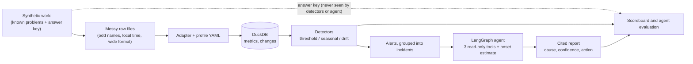

# Anomaly Agent

**Detect problems in e-commerce metrics, then investigate why they happened.**
A learning project: statistical anomaly detectors, a LangGraph investigation agent with read-only tools,
an optional LLM judge (Groq), and a scoreboard that grades all of it against a known answer key.

> **Status:** working prototype, built to learn. Results below come from a small, made-up world and a
> few real series. Read them as a sanity check, not as proof that it works in production.

## The problem

A fixed alert threshold ("ring the bell above 200 orders") has three weaknesses:

1. **False alarms** on normal spikes, like a planned sale day.
2. **Late detection** of slow problems, like a memory leak that creeps up for days.
3. **No explanation.** Someone still spends hours asking "what changed?"

This project tries to fix all three: learn what normal looks like, catch slow drift early, and have an agent
look for the likely cause and say how sure it is.

## How it works



**Why made-up data?** Real data rarely tells you exactly when a problem started or why, so you cannot score a
detector against it. A synthetic world has an answer key. The same code is also run on real data (see below).

**The made-up shop:** 30 days of 5-minute data (orders, payment decline rate by bank and region, latency, server
memory) with four planted events: a **sale day** (normal, a trap), a **bad deploy** that breaks one bank, a slow
**memory leak**, and a short **fraud burst** at a quiet hour with no internal cause.

**Detectors** (plain statistics, no ML model):

| Detector | Idea |
|---|---|
| Threshold | Fixed limits from the profile. The baseline to beat. |
| Seasonal | Median and spread for each hour of the week, learned from a clean start period. Knows planned event days. |
| Drift | Tracks the 1-day average and flags a steady change. For slow problems. |

A registry picks detectors by metric type (count, rate, gauge) from the profile.

**The agent** investigates one incident with three read-only tools (`query_metric`, `compare_segments`,
`get_recent_changes`) plus `estimate_onset` for slow problems. It writes a report where every claim cites its
evidence, or says "not enough evidence". It runs offline with rules, or with a **Groq LLM** that picks the next
tool and rates whether a change could plausibly cause the problem. All LLM output is validated; any failure falls
back to the rules.

## Results

**Detectors, made-up world** (minutes until the detector knew; all three find every problem):

| Setup | False alarms | Bad deploy | Fraud burst | Memory leak |
|---|---|---|---|---|
| Fixed threshold | 2 (the sale day) | 10 min | 10 min | 7.5 days |
| Seasonal | 0 | 10 min | 10 min | about 22 h |
| Seasonal + drift | 0 | 10 min | 10 min | about 12 h |

**Agent evaluation, 8 cases** (3 real causes, 2 with the true cause removed, 3 where a harmless, unrelated deploy
lands just before an outside attack):

| Agent | Cases passed | Confidently wrong |
|---|---|---|
| Rules only (scores a change by timing) | 5 / 8 | 3 |
| Groq LLM judge | 8 / 8 | 0 |

The rule-based agent trusts any change that landed just before the problem. The LLM judge rejects unrelated ones.
**Caveats:** one run on a small benchmark; the judge's scores vary between runs, and its rubric was written after
seeing the first failing case.

**Real data** (4 series from the public [Numenta Anomaly Benchmark](https://github.com/numenta/NAB)):
the seasonal detector finds all 5 labelled holiday and event windows in NYC taxi demand where a fixed limit
finds 1. But it raises hundreds of short alerts on two noisy real series, because "normal" learned once from the
first week goes stale. NAB's labelled windows are days wide and incomplete, so these numbers compare setups; they
are not accuracy scores.

## Quick start

Developed and tested on Python 3.13.

```bash
python -m venv .venv
.venv\Scripts\activate            # macOS/Linux: source .venv/bin/activate
pip install -r requirements.txt

python -m src.anomaly_agent.generator.make_raw          # make the messy raw files and the answer key
python -m src.anomaly_agent.adapters.csv_adapter        # clean them into DuckDB
python -m src.anomaly_agent.evaluation.run_compare      # run and compare the three detector setups
python -m src.anomaly_agent.agent.run_agent             # investigate every incident
python -m src.anomaly_agent.evaluation.agent_eval       # grade the agent against the answer key
python -m src.anomaly_agent.real.run_real               # real data (downloads NAB on first run)
pytest                                                  # 98 tests
```

Two Streamlit apps to explore everything (they are separate):

```bash
streamlit run src/anomaly_agent/app/app.py        # the original explorer
streamlit run src/anomaly_agent/app/app_llm.py    # adds the LLM agent, rules-vs-LLM evaluation, real data
```

### Optional: the Groq LLM

Everything works without it. To enable the LLM agent, create a free key in the Groq console, copy
`.env.example` to `.env`, and put the key after `GROQ_API_KEY=`. **Only in `.env`**, which is git-ignored.
Never put a key in `.env.example` or commit it (a test fails if a key-shaped string is tracked). Free tiers have a
daily token limit; the evaluation marks any case where the LLM was unavailable instead of hiding it.

```bash
python -m src.anomaly_agent.evaluation.agent_eval --llm
```

## Project layout

```
profiles/            ecommerce.yaml, nab.yaml: ALL business names and data rules live here
src/anomaly_agent/
  generator/         the made-up world, the messy raw files, the answer key
  adapters/          raw files -> clean DuckDB tables, driven by the profile
  detectors/         threshold, seasonal, drift, registry (no business words)
  tools/             the read-only agent tools (no business words)
  agent/             incidents, planner, LLM planner and judge, report, LangGraph graph
  llm/               the Groq wrapper, a recording wrapper, a scripted fake for tests
  evaluation/        scoreboard, detector comparison, agent evaluation, judge stability check
  real/              NAB download and the real-data run
  app/               the two Streamlit apps
tests/               98 tests
docs/plan.md         the build plan and status
```

## Design rules

- **Detectors and the agent never read the answer key.** Only the scoreboard and the evaluation do.
- **No business words** (bank, decline rate, ...) in `detectors/`, `tools/` or `agent/`. A new company needs a new
  profile, not new code. The real-data run is the proof: same code, a different profile.
- **Agent tools are read-only**, use parameterised SQL, and return small results. The agent can only call
  allow-listed tools and has a step limit.
- **Every agent claim cites a tool result**, or the report says "not enough evidence".
- **Time data is split by time, never randomly.**

## Known limitations and next steps

- The benchmark is small and made up. A larger randomised one (random problems, sizes, times, coincidences) is the
  top next step.
- "Normal" is learned once from a clean start period; real series that shift level raise many alerts. A rolling
  baseline is the natural fix.
- Events have a start time but no duration, so a real holiday can be missed by the agent.
- The LLM judge's scores vary run to run, which can flip a confidence level; a stability check is included
  (`evaluation/judge_stability.py`) but needs a quota to run.
- Planned: a fraud-detection model (time-split, PR-AUC) on public card-fraud data.

## Data and licence

NAB data is downloaded at run time from its public repository and is not stored here; it has its own licence.
There is no licence file for this project yet.
